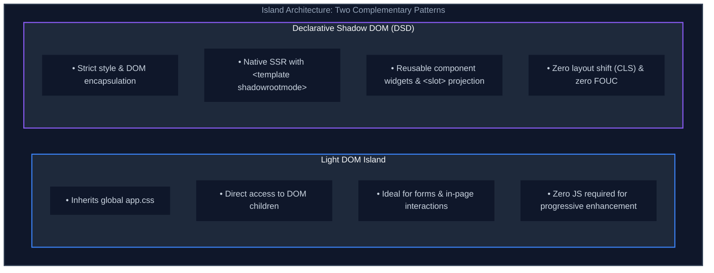

Gofs applications are multi-page applications (MPAs). Every route returns a complete, standards-compliant HTML page rendered on the server with Go's standard [`html/template`](https://pkg.go.dev/html/template). Dynamic interactivity is added to pages through **islands**: small, standards-based web components placed into server-rendered HTML that activate once their lightweight JavaScript loads.

The Go server owns the document structure, data fetching, and security boundaries. Web components own their local interactivity. Because neither layer oversteps its responsibilities, there is no client-side router, no global client state store, and no heavyweight frontend framework attempting to manage the entire document.

---

## Layout

The default template provides an evergreen HTML layout at `/internal/ui/layout.html`. It establishes the document shell, includes the global stylesheet, configures client-side module resolution with an [import map](https://developer.mozilla.org/en-US/docs/Web/HTML/Element/script/type/importmap), and defines the `content` template block that each page populates.

```html
<!doctype html>
<html lang="en">
  <head>
    <meta charset="utf-8" />
    <meta name="viewport" content="width=device-width, initial-scale=1" />
    <title>{{ .Title }}</title>
    <link rel="stylesheet" href="{{ asset "app.css" }}" />
    <script type="importmap">
      {"imports": {"lit": "{{ asset "vendor/lit.js" }}", "@lit/task": "{{ asset "vendor/task.js" }}"}}
    </script>
    <script type="module">
      // Load the JavaScript for every custom element present on this page, and nothing else.
      const tags = new Set([...document.querySelectorAll("*")].map((e) => e.localName).filter((n) => n.includes("-")));
      for (const tag of tags) import(`/components/${tag}/element.js`);
    </script>
  </head>
  <body>
    {{ block "content" . }}{{ end }}
  </body>
</html>
```

### The Zero-Bundler Island Loader

Notice the inline `<script type="module">` in the layout header. This small snippet acts as the entire "build and delivery system" for frontend code:
1. When the server renders a page, the browser parses the HTML.
2. The script queries the DOM for all custom elements (any tag containing a hyphen, such as `<todo-list>` or `<app-modal>`).
3. It dynamically imports `/components/<tag-name>/element.js` only for the components that actually appear on the page.

If a page has no interactive islands, **zero JavaScript is loaded**. If a page contains one island, only that component's file is fetched.

---

## Server Pages with Go `html/template`

Pages are standard Go templates residing in `/internal/ui/pages`. Handlers execute templates with the `ui.Render` helper:

```html
{{ define "content" }}
<main>
  <h1>{{ .Title }}</h1>
  <p>Welcome to an evergreen, standards-driven web application.</p>
</main>
{{ end }}
```

```go
func Hello() http.Handler {
	return http.HandlerFunc(func(w http.ResponseWriter, r *http.Request) {
		ui.Render(w, "hello/index", ui.Data{Title: "Hello World"})
	})
}
```

Go's standard `html/template` package automatically provides contextual auto-escaping (for HTML, attributes, JavaScript, and CSS), protecting your application against Cross-Site Scripting (XSS) vulnerabilities by default without external sanitation libraries.

### AI-Accelerated Template Authoring

In the past, developers sometimes avoided Go's `html/template` because writing nested templates, conditional logic, and HTML boilerplate felt verbose compared to JSX or specialized template languages like `templ`.

Modern AI coding assistants completely neutralize this friction. AI assistants excel at reading, generating, refactoring, and verifying standard Go templates and semantic HTML. Because `html/template` is part of the Go standard library and HTML is a stable W3C standard, AI produces accurate, idiomatic template code on the first attempt—giving you rapid authoring speed without coupling your project to proprietary compilers or runtime dependencies.

---

## Islands: Two Architectural Patterns

Gofs supports two complementary patterns for building web component islands: **Light DOM Islands** and **Declarative Shadow DOM (DSD) Islands**.



### 1. Light DOM Islands (Default)

For most in-page interactions (such as forms, lists, and search bars), the island should share the application's global typography, colors, and layout styles defined in `app.css`.

In a Light DOM island, the server renders standard HTML directly inside the custom element tag:

```html
<todo-list list-id="{{ .ID }}">
  <ul>
    {{ range .Items }}<li>{{ . }}</li>{{ end }}
  </ul>
  <form method="post" action="/list/{{ .ID }}">
    <input name="todo-list-item" required />
    <button>Add Item</button>
  </form>
</todo-list>
```

In component JavaScript (here illustrated using Lit as a lightweight custom element helper), we can render directly into the light DOM rather than creating a shadow root:

```js
export class TodoList extends LitElement {
  createRenderRoot() {
    return this; // Render directly into light DOM
  }
}
```

**Benefits:**
- Perfect progressive enhancement: the `<form>` works out of the box before JavaScript loads.
- Global styles in `app.css` apply immediately.

---

### 2. Declarative Shadow DOM (DSD) Islands

When a component requires **strict style encapsulation** (preventing global styles from leaking in, or internal styles from leaking out) or uses native `<slot>` projection, web standards provide **Declarative Shadow DOM**.

DSD is a native browser standard (Baseline Widely Available) that allows the server to emit shadow DOM trees directly in HTML using `<template shadowrootmode="open">`:

```html
<user-card user-id="{{ .ID }}">
  <template shadowrootmode="open">
    <style>
      :host {
        display: block;
        padding: 1rem;
        border: 1px solid var(--border-color, #ccc);
        border-radius: 8px;
      }
      .badge {
        font-size: 0.75rem;
        text-transform: uppercase;
      }
    </style>
    <div class="user-card-header">
      <span class="badge">{{ .Role }}</span>
      <h2>{{ .Name }}</h2>
    </div>
    <slot></slot>
  </template>
  
  <!-- Content projected into the slot -->
  <p class="bio">{{ .Bio }}</p>
</user-card>
```

#### Why DSD is a Major Leap Forward:
- **Instant Paint Without JavaScript**: Browsers immediately render the encapsulated shadow DOM while streaming the HTML, eliminating the Flash of Unstyled Content (FOUC) and Cumulative Layout Shift (CLS) historically associated with client-rendered web components.
- **True Server-Side Rendering (SSR)**: The Go server renders the entire component UI, while CSS scoping remains 100% enforced by the browser engine.
- **Native Web Component Hydration**: When client component scripts load, custom element classes (such as Lit or vanilla custom elements) automatically discover the existing shadow root rendered by DSD, seamlessly adopting the server-rendered DOM tree without recreating elements or flashing.

---

## When to Use Which Pattern

| Requirement | Recommended Pattern | Rationale |
| :--- | :--- | :--- |
| **Interactive Form / List** | **Light DOM Island** | Inherits `app.css`, enables simple progressive enhancement with standard HTML `<form>`. |
| **Encapsulated UI Widget / Card** | **Declarative Shadow DOM** | Provides strict style scoping and slot projection rendered instantly from the Go server. |
| **Modal / Dialog** | **Native `<dialog>` element** | Use browser standard `<dialog>` before reaching for custom component wrappers. |
| **Static Layout or Typography** | **Plain HTML/CSS** | No component or island needed. Keep indirection to a minimum. |


